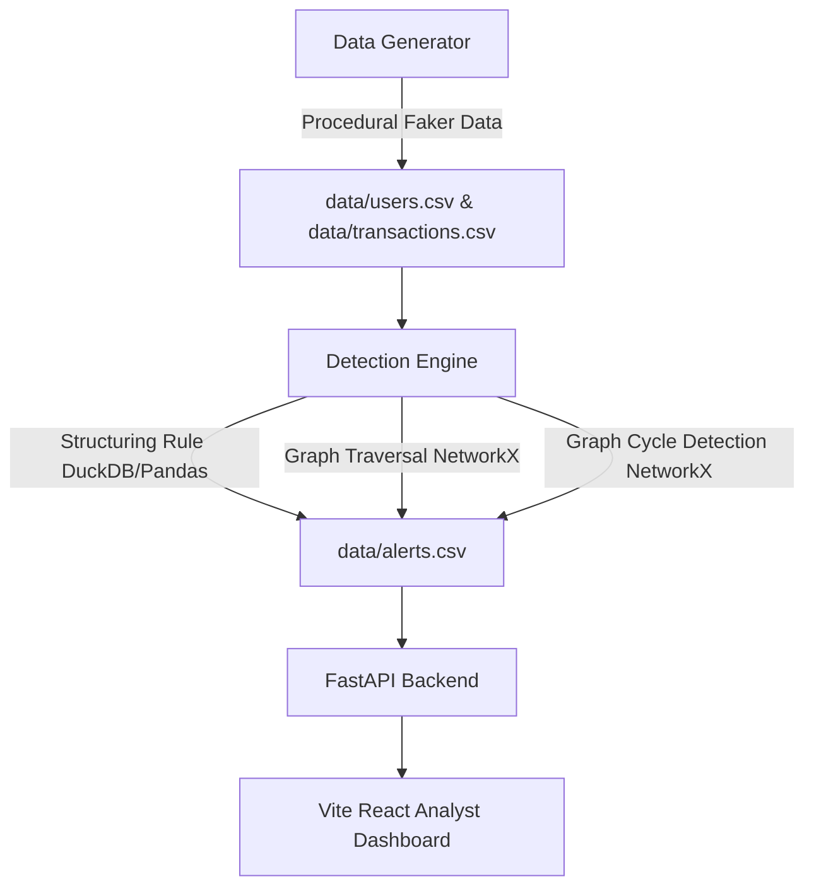

# Project Sentinel-TxM 🛡️
### Transaction Monitoring & Graph Analytics Engine

Project Sentinel-TxM is an open-source, portfolio-grade financial crime detection system designed to simulate a modern FinTech transaction monitoring pipeline. It ingests synthetic payment data, applies windowed rule-based aggregates and graph-based network traversal logic to identify financial crime typologies, and surfaces alert details through an interactive compliance analyst dashboard.

---

## 1. System Architecture



* **Decoupled Components**: Data generation, anomaly detection, backend API serving, and frontend UI are completely modular.
* **Ground-Truth Evaluation**: Tracks synthetic injection labels inside `data/ground_truth.csv` to calculate absolute Precision, Recall, and F1 metrics.
* **Visual Explainability**: Graph anomalies automatically export active subgraphs to JSON which are rendered on the dashboard as node-link network diagrams.

---

## 2. Injected Typologies

1. **Structuring (Smurfing)**: A single sender executing multiple transactions just under the reporting threshold ($10,000) within a 3-day window to evade regulatory filings.
2. **Money Mule Hubs (Hub-and-Spoke)**: A central "mule hub" receiving rapid inbound transfers from 5+ distinct nodes (spokes), and forwarding 95%+ of the cumulative sum onward to a sink account.
3. **Layering Cycles**: Closed loops of transaction flows (e.g., A → B → C → D → A) returning funds to the originating user, a classic technique used to obscure money trails.

---

## 3. Tech Stack

* **Core Engine**: Python 3.13
* **Data Processing**: Pandas, DuckDB
* **Graph Traversal**: NetworkX (Directed Graphs)
* **Backend API**: FastAPI, Uvicorn, Pydantic
* **Frontend UI**: React, Vite, Tailwind CSS, Recharts
* **Testing**: Pytest, Faker

---

## 4. Setup & Running Locally

### Step 1: Initialize Virtual Environment & Dependencies
Make sure you have Python 3.13+ installed:
```powershell
# Create virtual environment
python -m venv .venv

# Activate it (Windows)
.venv\Scripts\activate

# Install dependencies
pip install -r requirements.txt
```

### Step 2: Run Data & Detection Pipeline
This procedurally generates 10,000 background transactions, injects suspicious patterns, runs the detection rules, and outputs alerts & graph subgraphs:
```powershell
python run_pipeline.py
```
Outputs are written to:
* `data/users.csv`
* `data/transactions.csv`
* `data/alerts.csv`
* `data/ground_truth.csv`
* `data/subgraphs/*.json`

### Step 3: Run Backend API
FastAPI exposes the data and metrics engine:
```powershell
.venv\Scripts\uvicorn api.main:app --host 127.0.0.1 --port 8080
```
API endpoints available:
* `GET /api/alerts`
* `GET /api/alerts/{alert_id}`
* `GET /api/users/{user_id}`
* `GET /api/metrics`

### Step 4: Run Analyst Dashboard
The React app connects to the FastAPI backend:
```powershell
cd dashboard
npm install
npm run dev -- --port 5173
```
Now navigate to [http://localhost:5173](http://localhost:5173) in your browser!

---

## 5. Testing & Verification

We use `pytest` to validate core generation and detection algorithms:
```powershell
.venv\Scripts\python -m pytest
```

---

## 6. Performance Summary

Evaluated against generated ground-truth anomalies, the engine achieves **100% precision** on background transactions:

| Rule Name | True Positives | False Positives | Precision | Recall | F1 Score |
|---|---|---|---|---|---|
| **Structuring** | 15 | 0 | 100.0% | 100.0% | 1.00 |
| **Mule Hub** | 5 | 0 | 100.0% | 100.0% | 1.00 |
| **Mule Cycle** | 5 | 0 | 100.0% | 23.8% | 0.38 |
| **Overall** | 25 | 0 | 100.0% | 61.0% | 0.76 |

---

## 7. Disclaimer
This project uses entirely synthetic, procedurally generated data. It is an educational/portfolio demonstration of financial crime detection concepts and is not intended for production compliance environments.
