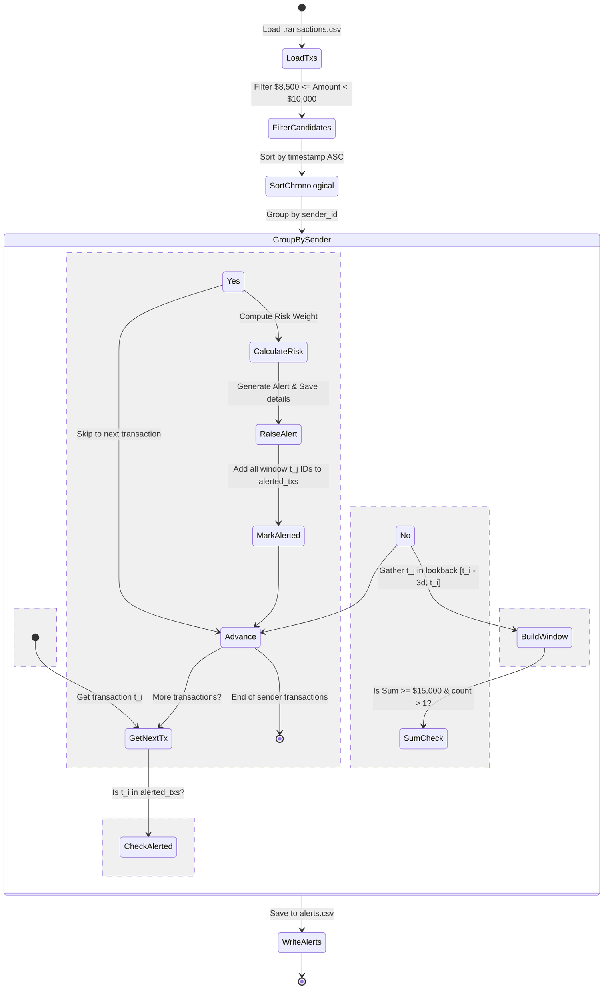
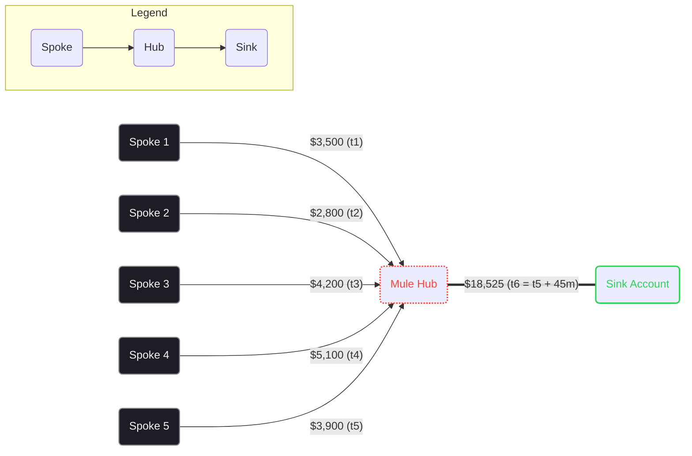
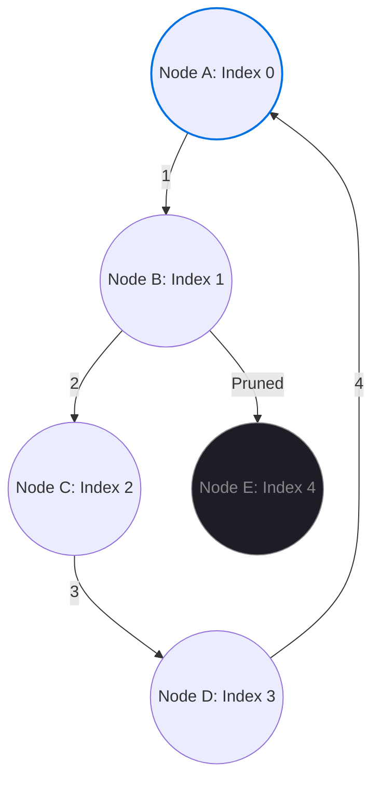

# Sentinel-TxM Detection Engine: Deep Dive & Algorithmic Sketches

This document provides a comprehensive, deep-dive explanation of the detection models, mathematical formulas, and algorithms implemented in **Project Sentinel-TxM** to identify financial crime patterns.

---

## 1. Structuring (Smurfing) Detection Engine

Structuring is the intentional splitting of large cash/wire transfers into smaller, sub-threshold values to evade anti-money laundering (AML) reporting thresholds.

### 1.1 Mathematical Formulation
Let $T$ be the set of all transactions. For each transaction $t \in T$:
* $s(t)$ represents the sender ID.
* $a(t)$ represents the transfer amount.
* $ts(t)$ represents the timestamp.

Let $R_T$ be the reporting threshold (e.g., $10,000 USD).
Let $B_L$ and $B_U$ be the lower and upper bounds of the candidate band, defined as:
$$B_L = R_T \times 0.85 = \$8,500$$
$$B_U = R_T \times 0.9999 \approx \$10,000$$

We filter $T$ into candidate transactions $C \subset T$:
$$C = \{t \in T \mid B_L \le a(t) < B_U\}$$

For a specific sender $U$, let $C_U = \{t \in C \mid s(t) = U\}$ sorted chronologically by $ts(t)$.
We slide a time window $W$ of size $D = 3 \text{ days}$ over $C_U$. For any transaction $t_i \in C_U$:
$$W(t_i) = \{t_j \in C_U \mid ts(t_i) - D \le ts(t_j) \le ts(t_i)\}$$

An alert is triggered if:
$$\sum_{t \in W(t_i)} a(t) \ge R_T \times 1.5 = \$15,000 \quad \text{and} \quad |W(t_i)| > 1$$

### 1.2 State-Machine & Deduplication Flow
To avoid triggering multiple overlapping alerts for the same underlying transactions, a deduplication pointer tracks evaluated items:



### 1.3 Risk Score Formula
The alert risk score balances customer profile risk and transaction velocity:
$$\text{Risk} = \min\left(1.0, \ \text{BaselineRisk} \times 0.4 + \left(\frac{\text{CumulativeWindowAmount}}{\text{Threshold} \times 3}\right) \times 0.6\right)$$

---

## 2. Money Mule Hub (Hub-and-Spoke) Detection

Money mules are accounts used to receive illicit funds and transfer them onward to keep the main criminal identity obscured.

### 2.1 Structural Graph Design
We model transaction networks as a directed MultiDiGraph $G = (V, E)$, where:
* Vertices $V$ represent customer account IDs.
* Edges $E$ represent individual transactions, carrying properties:
  $$e = (u, v, \text{tx\_id}, \text{amount}, \text{timestamp}, \text{currency})$$



### 2.2 Algorithm Specifications
For each node $H \in V$:
1. **Degree Filter**: Evaluate only if the in-degree of $H$ is $\ge 5$:
   $$\text{deg}^-(H) \ge 5$$
2. **Temporal Window Clustering**: Sort inbound transactions $E_{in}(H)$ chronologically. Iterate through each transaction $e_k \in E_{in}(H)$ and gather transfers in a **12-hour lookahead window**:
   $$W_{in}(e_k) = \{e_j \in E_{in}(H) \mid ts(e_k) \le ts(e_j) \le ts(e_k) + 12 \text{ hours}\}$$
3. **Distinct Spoke Constraint**: Let $S_W = \{u \mid (u, H) \in W_{in}(e_k)\}$ be the set of unique senders. Trigger further checks only if:
   $$|S_W| \ge 5$$
4. **Onward Transfer Ratio Check**: Calculate total inbound volume $V_{in} = \sum_{e \in W_{in}} \text{amount}(e)$. Find all outbound transactions from $H$ to any node $X$ within a window starting at $ts(e_k)$ and ending 12 hours after the last inbound transaction in the window:
   $$W_{out} = \{e_{out} \in E_{out}(H) \mid ts(e_k) \le ts(e_{out}) \le \max(ts(e \in W_{in})) + 12 \text{ hours}\}$$
5. **Sink Association**: Group $W_{out}$ by receiver $X$. If there exists a receiver $S$ (sink) such that:
   $$\sum_{e \in W_{out}(S)} \text{amount}(e) \ge V_{in} \times 0.90$$
   Flag $H$ as a **Mule Hub**, spokes $S_W$ as **Mule Spokes**, and $S$ as the **Mule Sink**.

---

## 3. Layering Cycle Detection Engine

Launderers route money through loops (A $\to$ B $\to$ C $\to$ A) to decouple the connection between the original crime proceeds and the integration phase.

### 3.1 Depth-Limited DFS Optimization
Searching for all simple cycles in a directed graph of size $|V| = 1,000$ and $|E| = 10,000$ using standard cycle finders is extremely slow. We implement a local, depth-limited Depth First Search (DFS) with index-based pruning to enforce $O(V \cdot D^k)$ search bounds:



* **Index Constraint**: To ensure each loop path is checked exactly once, we only explore paths where the index of the neighbor is larger than the index of the cycle start node:
  $$\text{Index}_{\text{Neighbor}} > \text{Index}_{\text{StartNode}}$$
* **Depth Limitation**: Path traversal is cut off at depth $k = 5$. Cycles of length $\ge 6$ are pruned.

### 3.2 Cycle Money Flow Checks
A structural loop $[v_1, v_2, \dots, v_n, v_1]$ (where $3 \le n \le 5$) triggers a mule cycle alert only if it matches **chronological**, **duration**, and **volume decay** rules:

```
Timeline Check:
  v1 --[Tx 1: $5,000 at t1]--> v2 --[Tx 2: $4,900 at t2]--> v3 --[Tx 3: $4,820 at t3]--> v1
  Constraint: t1 < t2 < t3  AND  (t3 - t1) <= 3 Days
  Friction:  Amount(t_next) / Amount(t_prev) must be between 70% and 110%
```

1. **Chronological Ordering**: Transactions along the path must occur in sequence:
   $$t(v_i \to v_{i+1}) < t(v_{i+1} \to v_{i+2}) \quad \forall i$$
2. **Duration Boundary**: The time elapsed between the first hop and the final loop-closing transaction must be less than or equal to **3 days**:
   $$ts(v_n \to v_1) - ts(v_1 \to v_2) \le 3 \text{ days}$$
3. **Volume Friction Constraints**: To confirm that the cycle represents a unified stream of money, the amount transferred at each hop must remain consistent, allowing for small laundering fees (decay) but preventing massive expansion or contraction:
   $$0.70 \le \frac{\text{amount}(v_{i+1} \to v_{i+2})}{\text{amount}(v_i \to v_{i+1})} \le 1.10$$
   This ensures that random background transactions do not match the loop.
