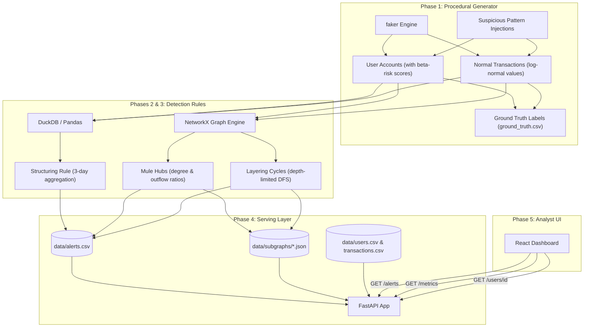
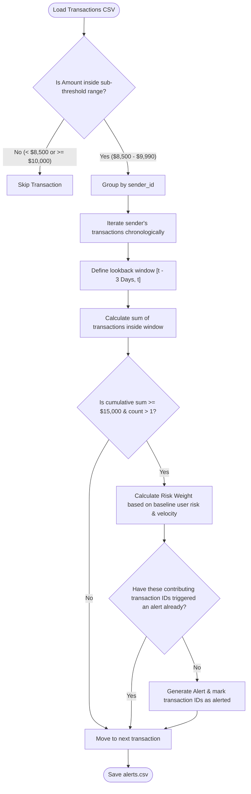
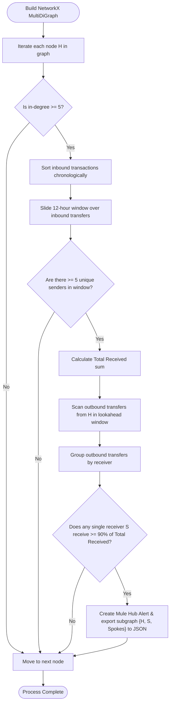
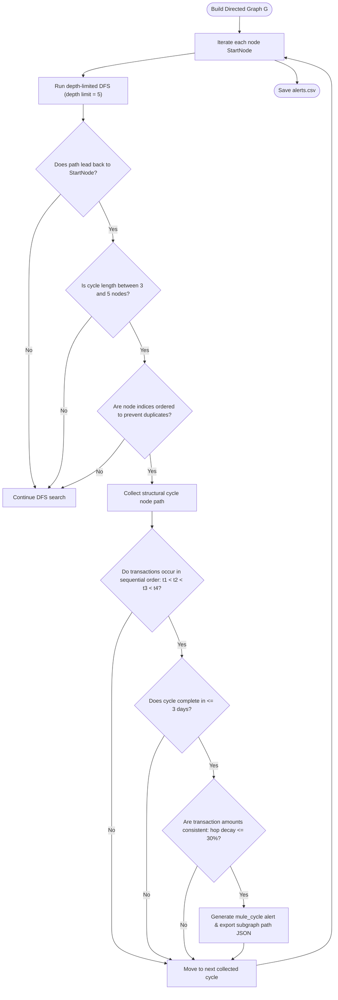

# Sentinel-TxM Architectural & Algorithmic Sketches

This document contains Mermaid diagrams illustrating the structure, logical flow, and graph algorithms used in **Project Sentinel-TxM**.

---

## 1. End-to-End System Data Flow

This diagram illustrates how transaction data is generated, processed, stored, and served to the user interface.

---

## 2. Structuring (Smurfing) Sliding-Window Logic

This diagram details the transaction-filtering and sliding-window aggregation logic used to identify attempts to bypass threshold reporting limits.

---

## 3. Mule Hub (Hub-and-Spoke) Detection Algorithm

This diagram demonstrates how NetworkX identifies high-velocity hub-and-spoke layering structures.

---

## 4. Layering Cycle DFS Loop Validation

This diagram details the optimized DFS search and timestamp sequence check used to locate laundering transaction loops.

